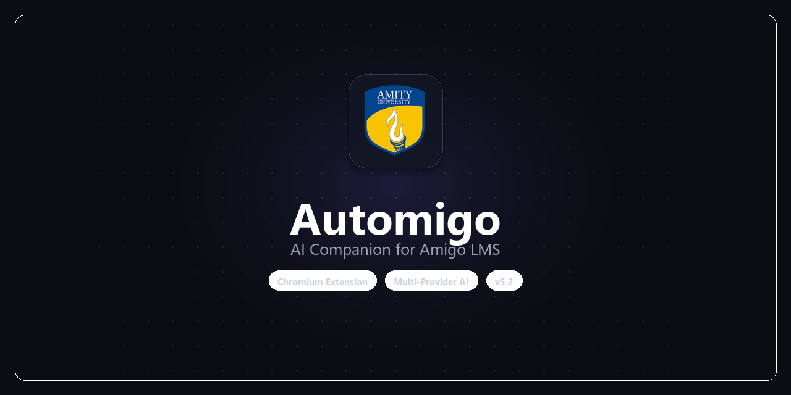

  

# ⚡ Automigo

Automated quiz solver & course runner for **Amigo LMS (Amity Online)** powered by multi-provider AI (Ollama, NVIDIA NIM, Groq, Google Gemini, OpenRouter, OmniRoute, OpenAI).

---

## 🌟 Highlights

- 🧠 **Smart Deduction Engine**: Guarantees 10/10 quiz convergence in 2–4 attempts via mathematical elimination.
- 🚀 **Full Course Automation**: Autonomous runner for Quizzes, Reading Activities, Feedback Forms, and Assessments.
- 🌐 **Multi-Provider AI**: Supports 100% free offline AI (Ollama) and free-tier cloud models (NVIDIA NIM, Groq, Gemini, OpenRouter).
- 🍿 **Background Keep-Alive**: Silent audio oscillator prevents browser tab freezing while you study or multitask.
- 🎨 **Proton Cyberpunk UI**: Sleek draggable glassmorphic overlay on LMS pages that auto-minimizes into a floating Amigo brand icon.

---

## 🚀 Quick Start

### 1. Install Extension
1. Download `amigo_extension.zip` or `amigo_extension.crx` from the [Releases](https://github.com/R-Rinku/Automigo/releases) page.
2. Open Chrome or Brave and go to `chrome://extensions/`.
3. Enable **Developer mode** (top-right toggle).
4. If using `.zip`: Extract it, click **Load unpacked**, and select the `amigo_extension` folder.
5. If using `.crx`: Drag and drop the `.crx` file onto `chrome://extensions/`.

### 2. Choose Your AI Provider
Click the **Automigo extension icon** in your browser toolbar to select your preferred AI backend:
- **Ollama (Free & Offline)**: No API key needed. Install Ollama and run `ollama run llama3.1`.
- **NVIDIA NIM (Free Credits)**: Free signup at [build.nvidia.com](https://build.nvidia.com).
- **Groq (Free Tier)**: Ultra-fast free API at [console.groq.com](https://console.groq.com).
- **Google Gemini (Free Tier)**: Free API key from [aistudio.google.com](https://aistudio.google.com).
- **OpenRouter**: Free `:free` community models at [openrouter.ai](https://openrouter.ai).
- **OmniRoute**: Local multi-model gateway running on port `20128`.

### 3. Run
1. Go to [amigo.amityonline.com](https://amigo.amityonline.com) and log in.
2. Click **START COURSE RUNNER** on the floating overlay.

---

## ⚙️ Rules & User Controls

- **Modules 1 to 5**: Solved automatically end-to-end.
- **Module 6**: Prompts for confirmation before proceeding to the final module.
- **Module Assessment**: Executes 1 attempt with reasoning AI. Prompts user before attempting any re-attempt (defaults to skipping after 15 seconds).

---

## 📄 License

MIT License
